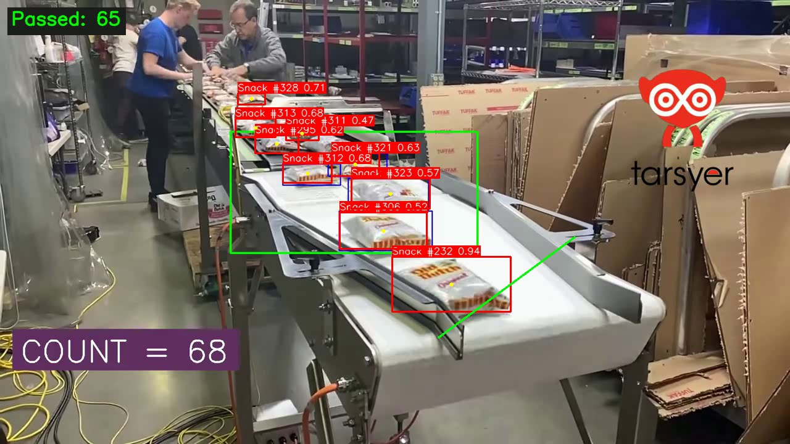
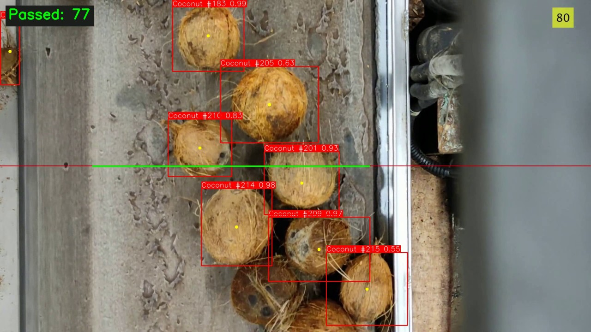

# Đếm vật trên băng chuyền bằng YOLO và ByteTrack

Hệ thống đọc video từ camera đặt trên băng chuyền, phát hiện và theo dõi từng vật, rồi đếm khi vật vượt qua một đường đếm. Có hai demo dùng model train riêng: gói snack và quả dừa.

```
Video -> YOLO26 (phát hiện) -> ByteTrack (gán track_id) -> Counter (đếm) -> Vẽ -> Hiển thị / lưu kết quả
```

| Snack | Dừa |
|---|---|
|  |  |

Đếm tay mù khớp với hệ thống: snack **105 / 105**, dừa **128 so với 128–129**. Chi tiết, hạn chế và cách đo ở phần [Kết quả](#kết-quả).

## Tài liệu thuyết trình

| File | Nội dung |
|---|---|
| [docs/CPV_Presentation.pptx](docs/CPV_Presentation.pptx) | Slide thuyết trình (tiếng Anh, 16 slide, có ghi chú người nói) |
| [docs/Script_EN.docx](docs/Script_EN.docx) | Kịch bản nói bằng tiếng Anh, kèm câu hỏi thường gặp |
| [docs/Script_VI.docx](docs/Script_VI.docx) | Kịch bản nói bằng tiếng Việt, kèm câu hỏi thường gặp |
| [docs/Report_EN.docx](docs/Report_EN.docx) | Báo cáo kỹ thuật bằng tiếng Anh |

## Cài đặt và chạy

Cần Python 3.10 trở lên. Trên Windows dùng `py`, trên macOS/Linux dùng `python3`.

```powershell
git clone https://github.com/hongan151206-ai/cpv_project.git
cd cpv_project
py -m pip install -r requirements.txt

py run.py                                # demo snack
py run.py --config config/coconut.yaml   # demo dừa
```

Nhấn **ESC** hoặc **q** để dừng, hoặc đóng cửa sổ.

| Tham số | Ý nghĩa |
|---|---|
| `--config` | File preset, mặc định `config/snack.yaml` |
| `--input` | Video khác, thay cho `input.path` |
| `--model` | Tên model trong `models/` (không có `.pt`) |
| `--conf` | Ngưỡng confidence |
| `--stride` | Xử lý mỗi N frame |
| `--no-display` | Không mở cửa sổ |
| `--save-video` | Lưu video kết quả `result.mp4` và `events.csv` vào `outputs/<thời gian>_<tên video>/` |

Kiểm thử (không cần model hay GPU): `py -m unittest discover -s tests -t .`

`events.csv` có một dòng cho mỗi vật được đếm (`counter, n, frame, seconds, track_id, x, y`), dùng để kiểm tra từng lần đếm.

## Kết quả

### Độ chính xác của việc đếm

Có hai mốc so sánh: **số đếm tay** (xem video đã ẩn kết quả của hệ thống, mỗi quả vượt đường xanh tính một lần, đếm hai lần) và **số in sẵn trong video**, do hệ thống của người quay video tạo ra. Video dừa có giai đoạn "Calibration" (số gốc giữ ở 0), nên số in sẵn chỉ tính phần sau giai đoạn đó.

| Video | Đếm tay | Số in sẵn | Đếm theo vùng (cũ) | Đường đếm (hiện tại) | Ghi chú |
|---|---|---|---|---|---|
| Snack (693 frame) | **105** | 105 | 131 | **105** | Khớp |
| Dừa, tua 4x (500 frame) | **128–129** | 129 | 174 | **128** | Đếm tay từ giây đầu; trước khi loại box trùng là 136 |
| Dừa, tốc độ thật (1818 frame) | chưa đếm | 129 | chưa đo | **131** | Cùng đoạn dừa, không chỉnh tham số riêng |

Số đếm tay khớp số in sẵn ở cả hai video, nên số in sẵn là mốc đáng tin. Khớp tổng số chưa chứng minh từng lần đếm đều đúng, vì lỗi thừa và lỗi thiếu có thể bù trừ nhau.

**Nguồn lỗi đã tìm ra ở video dừa.** Xuất từng lần đếm ra file cho thấy 8–9 lần đếm thừa đều có cùng một dạng: hai box chồng lên cùng một quả dừa (IoU 0.7–0.9), tracker gán hai ID khác nhau và cả hai cùng vượt đường trong cùng frame. YOLO26 không dùng NMS nên không tự loại box trùng, và `conf` thấp (0.1) làm lỗi này dễ xảy ra. Tùy chọn `duplicate_iou: 0.6` loại bản sao đó và đưa số đếm từ 136 về 128. Với video snack, bật tùy chọn này làm số đếm giảm từ 105 xuống 102 vì các gói thật chồng lên nhau, nên nó chỉ được bật trong preset dừa.

Tham số được chọn trên chính các video này, nên các con số trên lạc quan hơn mức có thể kỳ vọng với video mới.

### Độ chính xác của model

`coconut.pt` trên tập test của dataset `Coconut Conveyor Belt.v1i.yolo26` (8 ảnh, dataset này không nằm trong repo):

| Precision | Recall | mAP50 | mAP50-95 |
|---|---|---|---|
| 0.978 | 0.854 | 0.948 | 0.738 |

Tập test rất nhỏ. Metadata cho thấy `coconut.pt` được train trên dataset Kaggle `coconut-2`, khác với thư mục dataset trong repo, nên chưa loại trừ được khả năng hai tập trùng ảnh. Dataset của `snack.pt` không có trong repo nên chưa đo được chỉ số tương ứng.

### Tốc độ

Trên laptop RTX 3050 6 GB, chạy không hiển thị đạt khoảng 30–50 FPS (dao động theo trạng thái máy), nhanh hơn tốc độ gốc của cả hai video (15 và 30 FPS). Phần lớn thời gian (25–33 ms/frame) nằm ở YOLO; đếm và vẽ chỉ mất khoảng 1 ms. Khi mở cửa sổ khoảng 20 FPS với video 1080p (cửa sổ và chờ phím tốn thêm khoảng 10 ms/frame), nên demo dừa tua 4x phát chậm hơn tốc độ gốc; demo snack (15 FPS) vẫn đúng tốc độ. Lưu video và file txt làm chậm còn khoảng 17 FPS. Con số sẽ khác trên máy khác.

## Vì sao đếm chính xác hơn

1. **Đếm bằng đường đếm thay vì vùng.** Đếm theo vùng cộng mọi ID từng xuất hiện trong vùng, nên mỗi lần tracker đổi ID là đếm thừa. Đường đếm chỉ tính khi một track thực sự đi từ phía này sang phía kia.
2. **Giữ lại box độ tin cậy thấp cho tracker.** ByteTrack dùng các box này để nối track khi vật bị che. Vì vậy `conf_threshold` để ở 0.1. Với `conf` 0.5 như trước, cùng đường đếm chỉ được 89 (snack) và 126 (dừa, tổng).
3. **Khó tạo track mới hơn.** `new_track_thresh: 0.5` thay vì 0.25 giảm số ID rác. Ở video snack, đường đếm giảm từ 115 về 105, còn số track đi vào vùng giảm từ 225 về 141.

## Cấu hình

Thứ tự ưu tiên tăng dần: `config/settings.yaml` < preset < `.env` / biến môi trường < tham số dòng lệnh.

Đường đếm khai báo trong preset:

```yaml
counters:
  - type: line
    start: [300, 540]
    end: [1200, 540]
    direction: negative   # both | positive | negative
    duplicate_iou: 0.6    # tùy chọn: bỏ lần đếm thứ hai khi hai box trùng nhau (IoU) cùng vượt đường
```

Quy ước hướng: với đường vẽ từ trái sang phải, phía dương ở bên dưới, nên `positive` là đi từ trên xuống và `negative` là đi từ dưới lên. Đảo `start` và `end` sẽ đảo chiều.

Có ba loại counter:

| `type` | Ý nghĩa của số đếm | Khi nào dùng |
|---|---|---|
| `line` | Số vật đã vượt đường, mỗi track tính một lần | Đếm sản lượng (nên dùng) |
| `lane` | Số track từng ở trong polygon; `min_frames` lọc track quá ngắn | Vật không đi theo một hướng rõ ràng; dễ đếm thừa khi đổi ID |
| `zone` | Số vật **đang** ở trong hình chữ nhật, không cộng dồn | Theo dõi mật độ |

Tham số tracker nằm trong `config/bytetrack.yaml`. `iou_threshold` không có tác dụng với `snack.pt` và `coconut.pt` vì YOLO26 không dùng NMS.

Bật `saver.save_detections` để lưu file txt theo từng frame, mỗi dòng có dạng `class track_id conf x1 y1 x2 y2`.

## Hạn chế đã biết

- **`vid_stride` phải giữ bằng 1 khi đếm.** Bỏ frame làm tracker mất dấu: với `stride` 2 số đếm còn 58 (snack) và 61 (dừa), với `stride` 3 còn 29 và 5.
- **Đường đếm phải đặt ở nơi phát hiện tốt.** Trong video snack, đặt đường ở cuối băng chuyền, nơi gói hàng rơi và đổi hình dạng, số đếm chỉ còn khoảng 56.
- **Tham số gắn với góc quay.** Vị trí đường đếm tính theo pixel, đổi camera thì phải đặt lại.
- **Video mẫu có sẵn lớp phủ của hệ thống khác** (khung, số đếm, logo). Model có thể đã học từ các frame có lớp phủ đó, nên chưa chứng minh được độ chính xác trên video sạch.
- **Vật dính sát nhau.** Ở cuối video dừa, các quả xếp sát nhau tạo ra box trùng, có thể đếm thừa.

## Cấu trúc thư mục

```
cpv_project/
├── run.py                  # điểm vào, tham số dòng lệnh
├── config/
│   ├── settings.yaml       # cấu hình chung
│   ├── snack.yaml          # preset demo snack
│   ├── coconut.yaml        # preset demo dừa
│   ├── blind.yaml          # như coconut.yaml nhưng ẩn số đếm, để đếm tay
│   ├── blind_snack.yaml    # như snack.yaml nhưng ẩn số đếm, để đếm tay
│   ├── bytetrack.yaml      # tham số tracker
│   └── logging.yaml
├── core/                   # nạp + kiểm tra cấu hình, logging
├── src/
│   ├── pipeline.py         # vòng lặp xử lý video
│   ├── detector/           # YOLO + ByteTrack
│   ├── counter/            # line, zone, lane
│   ├── visualize/          # vẽ box và nhãn
│   └── saver/              # lưu ảnh, video, txt, crop
├── tests/                  # kiểm thử không cần model
├── models/                 # snack.pt, coconut.pt
├── inputs/videos/          # video demo
└── docs/                   # slide, kịch bản, báo cáo
```

## Train model

Script train và dataset không nằm trong repo này. `coconut.pt` được train trên dataset Kaggle `coconut-2` (theo metadata của model); `snack.pt` không có dataset đi kèm. Video mẫu là tư liệu có sẵn kèm lớp phủ của bên thứ ba, chỉ dùng để minh họa.
